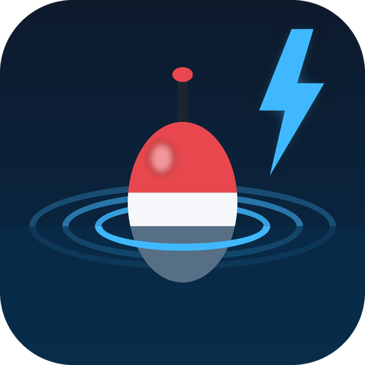

<p align="center">
  
</p>

<h1 align="center">Extreme Angler - One Key Fishing</h1>

<p align="center">
  A lightweight fishing addon for <b>World of Warcraft: Forever</b>.<br>
  One key to cast, the same key to catch - with a bite timer, catch stats and notifications.
</p>

---

## ⚡ Smart Cast

Every press of your fishing key does the **one thing you need next**:

| Your situation | What the key does |
|---|---|
| No fishing pole equipped | Equips the pole from your bags (weapons come back when you stop) |
| Pole has no lure | Applies the best usable lure in your bags |
| Ready to fish | Casts |
| Bobber is out | Catches the fish |
| Just caught something | Instantly ready to cast again |

**No automation:** Extreme Angler never acts on its own. Every action is one key press that you make.

See the full feature list, commands and FAQ in [ExtremeAngler/README.md](ExtremeAngler/README.md).

## Install

**From CurseForge** (recommended): search for *Extreme Angler* in the CurseForge app.

**Manually:** download the latest zip from [Releases](../../releases), extract it, and put the `ExtremeAngler` folder into:

```
World of Warcraft\_forever_\Interface\AddOns\
```

Restart the game. Your fishing key is `<` by default - type `/ea options` to change it.

## Development

```
ExtremeAngler/   the addon (Core, Gear, Stats, UI, Toast, Options + .toc)
.tools/          syntax checker (Node.js + luaparse) and the logo generator
media/           logo
build.sh         install into the game / package a release zip
CURSEFORGE.md    texts for the CurseForge project page
```

```bash
cd .tools && npm install && cd ..   # once, for the Lua syntax check
bash build.sh                       # bundle + syntax-check + install into WoW
bash build.sh package               # dist/ExtremeAngler-<version>.zip
```

`build.sh` installs to `C:\Games\World of Warcraft\_forever_\Interface\AddOns` by default; set `WOW_ADDONS` to use another folder. The installed copy is bundled into a single file so `/reload` picks up changes without restarting the game.

## License

[MIT](ExtremeAngler/LICENSE) © Silver Dyne (EU-PVE)
